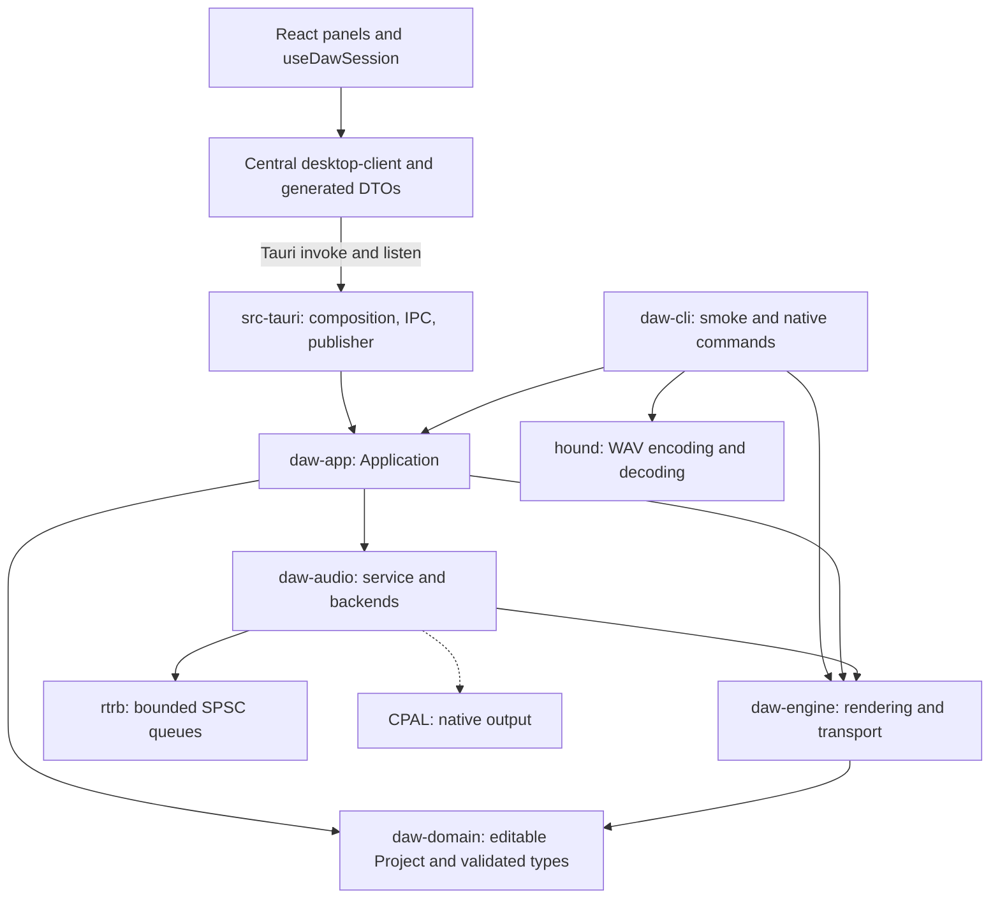
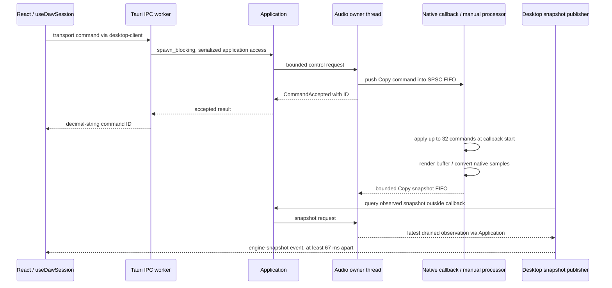

# Implemented architecture

This describes the foundation, offline export, and local stage 8 extension as of
2026-11-08. Desktop defaults to silence and offers explicit native sine audition;
ordinary smoke remains silent and export-wav writes signal. Future music
features belong to the [roadmap](roadmap.md). The normative processing and queue
rules are in the [realtime contract](realtime-contract.md); the rationale is in
[ADR 0001](adr/0001-core-and-desktop-boundaries.md).

The [offline oscillator contract](offline-oscillator.md) describes the optional
sine module inside the engine, independent application offline coordination,
and CLI WAV I/O. hound 3.5.1 is confined to CLI. The live service and desktop can
explicitly initialize the same oscillator with gain ramps; see
[native audition](native-audition.md). The export branch runs before Application::new,
so exporting creates no audio service thread.

## Package dependencies

Arrows mean “depends on.” Dashed edges require `native-audio`.

`daw-domain` and `daw-engine` have no external dependencies. The engine receives
caller-owned interleaved `f32` buffers; it knows nothing about devices, JSON,
Tauri, or React. `daw-audio` owns scheduling and device lifetime, not project
editing. Its manual backend drives the same realtime processor explicitly, with
no timer and no audio device. CPAL is optional in audio, application, and CLI;
desktop explicitly enables it. See the [platform/build matrix](development.md).

`daw-app::Application` owns the editable project and audio service and coordinates
their use cases. The CLI uses this application for offline smoke and device/native
diagnostics, plus engine configuration types. Desktop invokes the application through eleven
registered commands; it does not implement another engine. A single virtual
Cargo workspace, root lockfile, and target directory serve all six packages.

## Three distinct states

Offline export uses `daw-app::offline::OfflineRender`, independent of the live
Application/document. It constructs its own engine and bounded scratch buffer,
renders complete blocks, then delivers samples to the CLI writer after render
returns. File creation, encoding, seeking, and finalization stay in CLI.

| State             | Owner                                       | Meaning                                                                                                        |
| ----------------- | ------------------------------------------- | -------------------------------------------------------------------------------------------------------------- |
| Editable document | `Application::project`                      | Validated project ID, title, and tempo; independent of playback.                                               |
| Playback state    | `AudioEngine` inside the realtime processor | Configuration, applied tempo, transport, device frames, and transport frames.                                  |
| Observed state    | Audio controller, then desktop/UI           | A delayed snapshot with service state, sequence, callback count, last applied ID, output selection, and error. |

A tempo request validates BPM, enters the bounded command queue, and only then
changes the document. The engine changes tempo at a later callback boundary. If
shutdown discards pending commands, the document retains the accepted tempo and
supplies it on restart. A successful invoke acknowledges acceptance; React uses
observed snapshots to show applied transport and tempo. Local input text and a
pending command ID are not playback confirmation.

## Control and observation flow

Native voice frequency and gain are playback state, outside the editable document.
The engine owns per-frame ramps; the service selects the signal before starting
the stream. Requested transport and actual transport differ while releasing.
Optional allocator/timing diagnostics run only under rt-diagnostics; default
desktop has no measurement instrumentation. Larger control responses box snapshots
outside the callback while realtime SPSC payloads remain Copy.

The event can arrive before the invoke reply; the hook reconciles the accepted
ID against its latest observation. Listeners are registered before initial state
queries. The hook rejects older/equal sequences using `BigInt`, cleans up listeners
under StrictMode, and disposes subscriptions whose async registration finishes
after unmount. Browser mode disables native operations. Opening audio requires
an explicit click; mounting React never opens a stream.

## Desktop boundary and resource closure

Serde DTOs define the camelCase wire format; ts-rs generates TypeScript. Large
integer counters and IDs are decimal strings. `desktop-client.ts` centralizes
invoke/listen. Domain hooks coordinate use cases; panels display their state.
The [realtime contract](realtime-contract.md) defines acknowledgements and errors.

`DesktopState` holds `Mutex<Option<Application>>` outside the callback. IPC work
runs on blocking workers. The publisher uses `try_lock` to skip busy application
access, queries observed state, emits only changed sequences to `main`, and waits
at least 67 ms after each iteration. This is a UI update limit, not an audio clock.
Generated application ACL permissions and event listen/unlisten are granted only
to the local `main` window. Production CSP remains explicit, with no remote
capability or plugin enabled.

On main-window destruction or application exit, desktop stops and joins the
publisher, marks state closing, takes and drops the application. Dropping its
audio service sends an exit request and joins the owner thread, which destroys
the stream and queues. Remaining handles report `ServiceClosed`. Explicit audio
shutdown leaves the application/document alive for reinitialization; exiting
drops them. Native driver calls may block, so this is orderly ownership rather
than a hard upper bound on shutdown time.

See [development and verification](development.md) for mock-runtime tests versus
actual WebView2/hardware evidence and [the final requirements audit](../progress/cierre-etapa-6.md).
