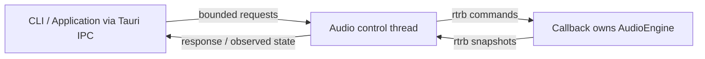

# Realtime contract

This is the principal contract for the implemented engine, audio service, and
desktop observation boundary as of 2026-11-09. See [architecture](architecture.md)
for package diagrams and [development](development.md) for verification scope.

The [offline oscillator contract](offline-oscillator.md) describes the implemented
stage 7.2 engine mode and stage 7.3 application/WAV export. The service and desktop
default to silence and now offer explicit [ramped native audition](native-audition.md).
Ordinary smoke paths retain silence. export-wav uses an independent engine
and performs encoding/file I/O only after engine rendering returns, with no service
initialization or native callback involvement.

## Ownership and data flow

`AudioService` owns one control thread. Cloneable `AudioHandle` values serialize
requests through that thread. All device enumeration, stream construction, play,
and destruction occur on the control thread. The native callback owns the engine,
the command consumer, the snapshot producer, and its preallocated conversion
scratch buffer. The manual backend drives the same realtime processor only when
explicitly asked to render; it has no timer or fake device.

Sampler sessions added in 9.4.b move a prepared bank through the ordinary control
request channel, never the realtime FIFO. A native stream guard closes CPAL then
reclaims the owning processor via a one-slot teardown mailbox, so PCM destruction
occurs on the control owner even if CPAL destroys its callback closure on a worker.
This mailbox is used only by closure teardown, outside processing. Teardown can
wait for the backend; the request deadline does not bound driver destruction.
See [sampler sessions/outcomes](sampler-service.md) for lifecycle and evidence limits.

The engine depends on domain types only. CPAL is confined to `daw-audio` behind
`native-audio`. The feature propagates through `daw-app` and `daw-cli`; desktop
enables it explicitly. `Application` owns the editable project and service. Its
transport methods share the same service API used by the CLI. Desktop DTOs,
serialization, application locks, and UI events stay outside the realtime processor.

## Engine buffers and transport

The editable `Project` is independent of engine state. `Tempo` accepts finite
20–300 BPM inclusive. Engine configuration accepts positive `u32` sample rates
and positive `u16` channel counts; backends impose the tighter channel limit below.
The caller owns interleaved `f32` output buffers. The default engine overwrites
every sample with zero; `AudioEngine::with_sine` explicitly selects a sine signal
while playing. Rendering permits variable-sized and empty buffers. Buffers must
contain complete frames. Misalignment or checked counter overflow silences the
whole buffer, returns `RenderError`, and leaves engine state unchanged.

Direct engine commands apply synchronously between render calls. Device frames
advance on every valid rendered block; transport frames advance only while
playing. Pause preserves position, Play resumes, and Stop resets transport
position without resetting device frames. Tempo changes preserve both counters.
The optional oscillator preserves phase across blocks and Pause, resets phase on
Stop, and advances once per playing frame regardless of channel count. Stopped
and paused output is silence. Invalid renders preserve phase as well as counters;
empty buffers do not advance it. Frequency is independent of BPM. There is no
event scheduling. At the service boundary, commands instead wait for the next
callback, as specified below. Service initialization defaults to silence and can
explicitly select a ramped sine. The [native audition contract](native-audition.md)
defines the 5 ms per-frame envelope, gain validation, and release tails. The
immediate offline oscillator/export semantics above remain unchanged.

The audio-library API can also initialize an owning sampler engine manually or
through CPAL, with matching bank/device rate and channels, master ramps and fixed
headroom. Desktop initialization/trigger DTOs are implemented in
[stage 9.4.c](sampler-desktop.md), with explicit preparation/session controls.

## Limits and overflow

Stages 9.1–9.3 add PCM, fixed voices and bounded bank preparation. 9.4.a–b connect
sampler transport/headroom, sessions and Copy trigger outcomes through the existing
FIFO. The [sampler contract](sampler-contract.md) and [session contract](sampler-service.md)
define implementation and verification limits; [9.4.c](sampler-desktop.md) adds desktop DTO/UI wiring.
Raw-kernel/adapter memory tests and sine timing measurements do not
establish native sampler callback deadlines or physical continuity.

| Boundary                             | Capacity / policy                                                           |
| ------------------------------------ | --------------------------------------------------------------------------- |
| External control requests            | 32 queued requests; nonblocking submission returns `Busy` when full.        |
| Realtime command FIFO                | 128 Copy commands; `QueueFull` rejects without consuming a command ID.      |
| Commands applied per callback        | At most 32, once at the start of the callback.                              |
| Snapshot FIFO                        | 64 Copy snapshots; publication may be skipped if full.                      |
| Snapshot drain on control thread     | At most 64 entries per iteration; control polls every 5 ms.                 |
| Control response deadline            | 10 seconds; expired queued requests are rejected before execution.          |
| Native stream initialization timeout | CPAL receives a 3-second timeout; backend support varies.                   |
| Native scratch buffer                | 256 frames times negotiated channels, allocated before starting the stream. |
| Manual render request                | 0–4096 frames; zero is a no-op and does not apply commands.                 |
| Backend channel counts               | 1–32 channels.                                                              |

Native callbacks larger than the scratch capacity are rendered in aligned chunks.
The 32-command budget applies to the entire callback, not each chunk. Every
callback retries snapshot publication using its current cumulative state and
last applied command. Consequently, once space becomes available, later callbacks
recover the newest acknowledgement even if an earlier publication was skipped.
Native preflight validates the whole output sample count after command processing
and before any scratch chunk renders, preventing partial frame advancement on
a later counter overflow. Sampler observations include an exact last-trigger ID,
Copy result, voice count and saturating started/rejected counters. Intermediate
outcomes can be lost; a cumulative processed acknowledgement is not proof that
each trigger started. Match exact outcome IDs; do not infer an older result from
a newer trigger. Stage 9.4.c exposes these observations through generated DTOs with exact-ID outcome matching and Unknown for lost results.
No guarantee is made about telemetry delivery after callbacks stop permanently;
the service reports a signaled stream failure without waiting for an acknowledgement.

The external response channel is never accessed by callbacks. A timeout means an
operation already executing may still finish, especially in an OS driver call.
Query state before retrying; requests are not automatically retried. Backend
timeouts do not guarantee that every OS call will return within that duration.

## Acceptance and application

An accepted command receives a monotonically increasing `u64` ID. Only successful
pushes consume an ID. Commands remain pending until a callback applies them.
Snapshots expose `last_applied_command`; cumulative acknowledgement covers earlier
accepted IDs in the current stream. After restart, pending commands
from the previous stream are discarded explicitly as part of shutdown; new IDs
continue increasing and the last-applied field starts empty.

The control thread maintains a monotonic observation sequence. It seeds ready
state with zero callbacks; native initialization may refresh observations before
returning. Initialization confirms that native `play()` succeeded, while snapshots
with callback/frame progress prove actual processing. Counters and IDs
remain Rust `u64` values. Desktop serializes them as decimal strings rather than
JavaScript numbers. Command ID exhaustion returns `Busy` before enqueueing;
observation sequence increments saturate at `u64::MAX`, so strict growth is bounded
by that range. Callback/device/transport counters use checked arithmetic.

`Application::transport_set_tempo` validates BPM before submission and changes the
editable document after acceptance. Playback tempo changes only after application.
If audio fails or shuts down with a command pending, the document retains the
accepted tempo and supplies it to the next initialization.

## Lifecycle and errors

For a ramped sine, an applied Play/gain/Pause/Stop command sets a target at the
callback boundary. Acknowledgement does not assert ramp completion. Snapshots
also expose requested transport, effective/selected gain, and remaining ramp frames.
Pause/Stop keep actual transport playing through the release tail; Stop resets
phase/position only at zero gain. Shutdown and failure can drop a stream immediately,
without completing a fade. Reinitialization starts the native voice at zero gain
with selected gain one; signal settings do not change the project document.

Service state is separate from transport state: `Uninitialized`, `Ready`, `Error`,
and the internal `ShuttingDown` transition. Initializing a ready service returns
`Busy`; shut it down first to switch outputs. Shutdown is synchronous and
idempotent. It drops the stream and queues on their owner thread, clears the
observed engine, and returns uninitialized. Initialization after shutdown or error
creates a fresh stopped engine at position zero, without resetting service-level
IDs or observation sequences. Dropping `AudioService` sends an exit request and
joins its thread; surviving handles then return `ServiceClosed`. Shutdown and Drop
do not wait for a callback acknowledgement, though native driver calls may block.

Callback errors only set a small atomic failure flag. Outside the callback, the
control thread closes the stream, retains the last observed engine state for
diagnostics, publishes `Error`, and rejects new transport commands. Reinitializing
rebuilds the stream. Error payloads contain a code and message; no error text is
formatted in the callback. Render errors signal failure and produce safe silence.

Tests inject a stream-failure signal to verify this path; physical unplug/replug
has not been verified. No logs or details of the original CPAL error are retained
by its error callback; diagnostics report a generic stream-failure message.

## Device configuration and formats

Enumeration returns CPAL device IDs, labels, default-output status, and
supported channel/sample-rate/format ranges. Initialization uses either the
default output or an exact enumerated ID, then its default supported configuration.
There is no fallback to another device, transparent hot-swap, ASIO, resampling, or
user-selected sample-rate/buffer-size negotiation in this stage.

Native conversion supports `f32`, `f64`, and signed/unsigned 8-, 16-, 32-, and
64-bit samples. Other formats, including packed 24-bit formats, return
`UnsupportedSampleFormat`. Conversion uses CPAL sample conversions, including
unsigned silence at the format's midpoint. Unsupported channel counts return
`UnsupportedChannels`. Native snapshots retain the actual device ID, name, format,
sample rate, and channel count. Only stereo `f32` at 48 kHz has been exercised on
hardware so far; unit tests check unsigned silence conversion.

Device IDs are opaque identifiers from CPAL, not a promise that an OS preserves
an identifier across device removal, driver updates, or host changes.

## Desktop snapshots and JSON

Serde DTOs in `src-tauri/src/ipc/dto.rs` define camelCase JSON. The generated
TypeScript contract is `src/shared/api/generated/api.ts`; run
`npm run bindings:generate` and `npm run bindings:check` on a desktop-capable host.
Project IDs, command IDs, observation sequences, frame counts, callback counts,
and nullable last-applied IDs use decimal strings. Rates, channels, and BPM remain
JSON numbers. React uses `BigInt` for ordered IDs/sequences. Nullable sine frequency
and amplitude, effective/target gain, and u32 remaining ramp frames are JSON numbers;
requested transport uses the existing transport enum. Optional Rust diagnostics
are deliberately absent from the desktop DTO and generated bindings.

The controller drains telemetry outside the callback; the desktop publisher
queries that observed state outside the callback and emits `engine-snapshot`
only for changed sequences, with at least 67 ms between iterations (below 15 Hz).
Busy application access skips an iteration. UI telemetry is delayed, may omit
intermediate states, and is not sample-accurate. A ready snapshot alone confirms
initialization, not callback progress; inspect callbacks and frames.

React subscribes before querying initial state, discards stale observations,
and reconciles pending IDs even when an event precedes its invoke response.
Shutdown/error clears pending UI indication; this does not mean those commands
were applied. A cumulative acknowledgement after restart confirms commands of
the current stream; earlier-stream pending commands were discarded on shutdown.

Errors cross IPC as `{ code, message, details }`. Service codes are
`InvalidArgument`, `Uninitialized`, `QueueFull`, `Busy`, `DeviceAbsent`,
`UnsupportedSampleFormat`, `UnsupportedChannels`, `NativeAudioDisabled`,
`StreamError`, `Timeout`, and `ServiceClosed`; wire codes are camelCase. Desktop
adds `ipcError` for adapter failures. Validation, queue rejection, and runtime
stream failure remain distinct. The UI shows structured failures and offers
explicit recovery without browser/native fallback.

Main-window destruction/exit stops and joins the publisher before dropping the
application and joining the audio owner thread. Explicit shutdown closes audio
while preserving the document. Neither path waits for callback acknowledgement.

## Callback constraints and evidence

The normal callback contains no application I/O, logging, serialization, Tauri
calls, blocking locks, waits, or dynamic allocation. Optional rt-diagnostics
adds allocator/timing/sample probes. Release measurements on identified Windows
hardware and an allocator-instrumented native chunk test supplement inspection;
see the [stage 8 report](../progress/etapa-8.md). Diagnostic timing compares processing
time with frames/sample-rate, excluding host/driver work and callback arrival
jitter. It cannot establish absence of dropouts or acoustic continuity. The
[native contract](native-audition.md) specifies metrics, one-callback publication
lag, overhead, and explicit unverified cases.

## Dependency references

- [CPAL 0.18.2 API](https://docs.rs/cpal/0.18.2/cpal/).
- [CPAL device and stream methods](https://docs.rs/cpal/0.18.2/cpal/traits/trait.DeviceTrait.html).
- [rtrb 0.4.1 API](https://docs.rs/rtrb/0.4.1/rtrb/).
