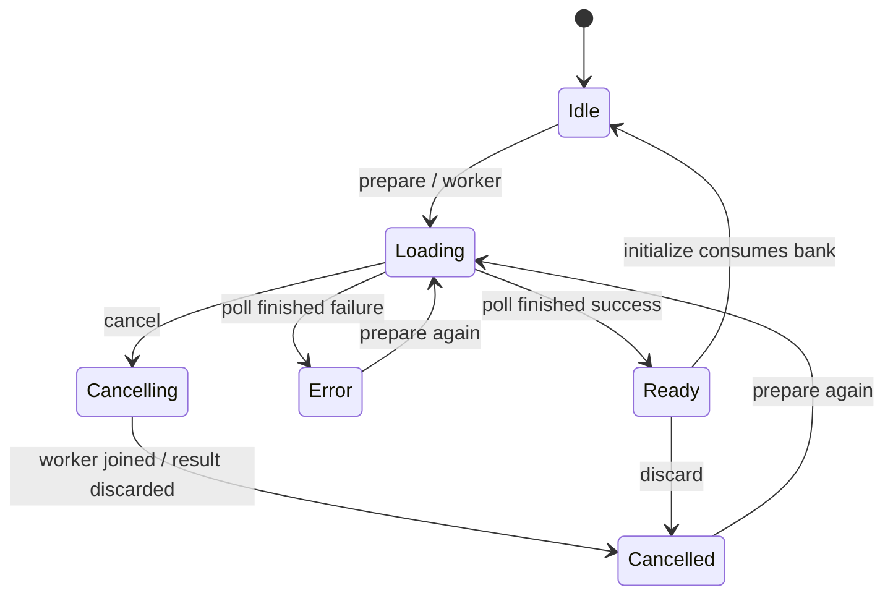

# Sampler application and desktop contract — 9.4.c

Implemented locally on 2026-11-09. Application, generated DTOs, IPC/ACL and React
now connect the [preparation](sample-loading-contract.md) and
[audio session](sampler-service.md) contracts. Tests use real temporary WAV files,
manual audio and the Tauri mock runtime; this does not verify physical audition.
The [9.4.d audit](sampler-integration-acceptance.md) closes integration locally
and fixes device-list recovery and automatic poll overlap across effect lifetimes.

## Preparation and session lifecycle

Application owns one preparation coordinator, one optional worker and one pending
PreparedBank. Close audio first: preparation and bank installation require an
Uninitialized service. Ready, Error and ShuttingDown services must be shut down
explicitly. Silence/sine initialization returns Busy while preparation or its
ready result exists. This first desktop flow does not replace an active bank.
The existing library coordinator can account for active/preparing coexistence;
Application supplies no active bank because audio is closed before preparation.

prepare_samples validates mono/stereo, at most 16 unique slots (0–15), nonempty
paths of at most 32768 native string units and an EngineConfig before spawning
the named preparation worker. Path lengths use platform OsStr units, not a claim
about OS filesystem limits. WAV validation/decoding stays on that worker, outside
the Application mutex, audio controller and processing callback. It returns a
Loading snapshot immediately; the worker never needs the Application mutex.
Paths are explicit local user input, not persisted project assets.

get_sample_preparation joins only a finished worker. A complete result becomes
Ready and retains the coordinator permit until installation/discard. Failure
becomes Error with slot/error context; no partial bank is published. Empty banks
are valid in the API, while the UI requires at least one path. Each new preparation
has a monotonic ID; stale cancel/install IDs fail without changing current state.

Cancellation marks the worker's atomic flag and enters Cancelling until ownership
returns. At the application publication boundary, cancellation also discards a
successful but unpublished result. Cancelling/discarding a ready bank frees its
PCM and permit outside processing. No second worker starts until the previous one
has been joined. Application destruction cancels and joins an outstanding worker.
An OS read cannot be interrupted by the flag, so shutdown has no bounded latency.

initialize_sampler consumes the exact ready preparation and transfers its bank to
AudioHandle. Native initialization uses the exact bank rate/channels; unsupported
hardware fails explicitly. The bank is consumed on initialization failure as well
as success: prepare again to retry. The application-only manual initializer is
used by tests, not exposed as a desktop command. Initialization never issues Play
or a trigger. Stop retains PCM; audio shutdown releases the session. Session/source
selection and file paths do not change the editable project document.

## Wire format and observations

The five new commands are prepare_samples, get_sample_preparation,
cancel_sample_preparation, initialize_sampler and trigger_sample. Together with
the eleven existing commands, the local main window has sixteen application
commands. Generated ACL grants no command to other windows or remote origins;
there is no filesystem plugin permission or manual processing IPC command.

PreparationSnapshotDto contains a separate monotonic sequence, preparationId,
state (idle/loading/cancelling/ready/cancelled/error), output rate/channels,
occupied-slot mask, retainedPcmBytes and error text. Preparation IDs and sequences
cross JSON as canonical decimal strings; commands reject numeric/noncanonical IDs.
Byte counts also use strings. Error text describes preparation failures;
admission errors use the existing structured ApiError codes.

ServiceSnapshotDto.sampler is null for silence/sine. Sampler sessions expose the
occupied-slot mask, active voice count, saturating started/rejected string counters
and optional lastTrigger. Its commandId is a string; outcome is a discriminated
union: started with reusable voice index, or rejected with typed reason
noSampler/invalidSlot/missingAsset/notPlaying/poolFull.

trigger_sample acceptance is only queue admission. lastAppliedCommand confirms
processing, including rejection. Match lastTrigger.commandId exactly to report a
voice started or a rejection. If processing advances past a pending trigger but
its exact outcome was lost, display Unknown. Session closure also resolves a
pending trigger to Unknown. A known result stays known; newer snapshots cannot
rewrite it. Started confirms activation, not audible output.

React registers audio snapshot events before initial queries and reconciles
snapshots arriving before invoke replies. BigInt comparisons reject stale/equal
sequences. Preparation uses a separate sequence and nonoverlapping 200 ms polling
only while Loading/Cancelling; response latency is added to that interval. A
persistent in-flight guard prevents overlapping automatic polls across effect
cleanup/replacement. Explicit commands are not globally serialized by this guard.
Initial device and preparation queries are independent, so enumeration failure
does not hide a ready bank or prevent its discard.
Cancellation/unmount stops polling and ignores late replies. Loading never opens
audio. Browser mode performs no native calls. The UI provides explicit preparation,
discard, initialization, Play, trigger and gain actions; one displayed trigger may
be pending at a time, without pretending there is a lossless outcome history.

See the [Spanish walkthrough](../howToRunThis/06-sampler.md) and
[implementation report](../progress/etapa-9-aplicacion-sampler.md). Stage 9.4.d
closes integration locally; the [native protocol](sampler-native-verification.md)
tracks native verification; the [sampler-specific runner](sampler-diagnostics.md)
is now implemented in 9.5.a with device-free tests.
Mixer, sequencer, persistence/export and clips/scenes remain stages 10–13.
