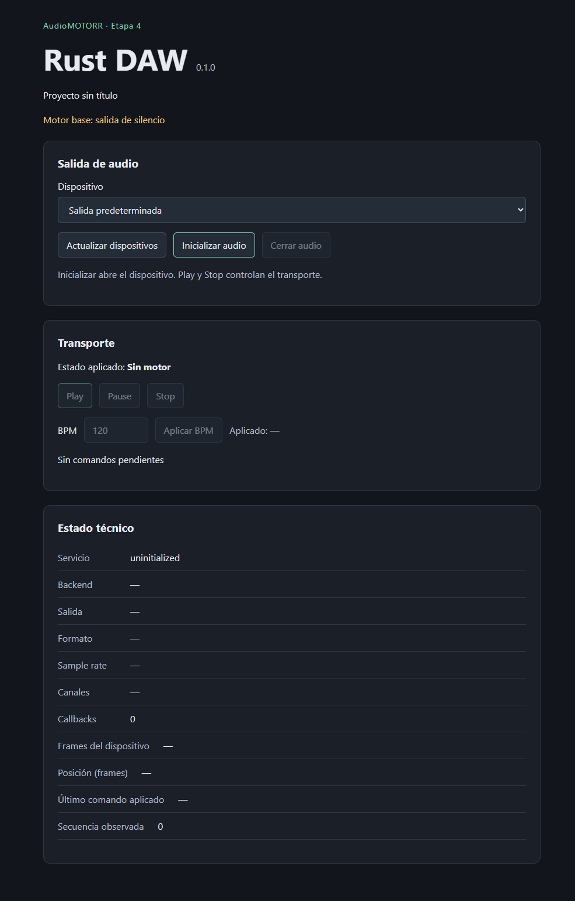
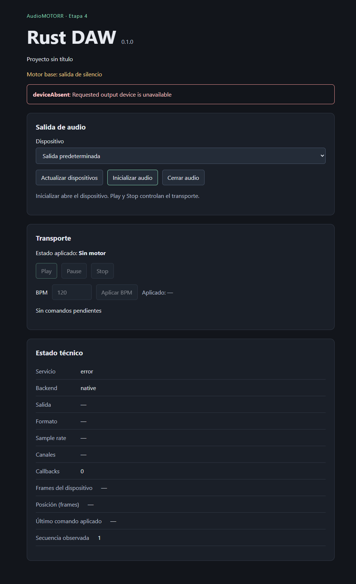
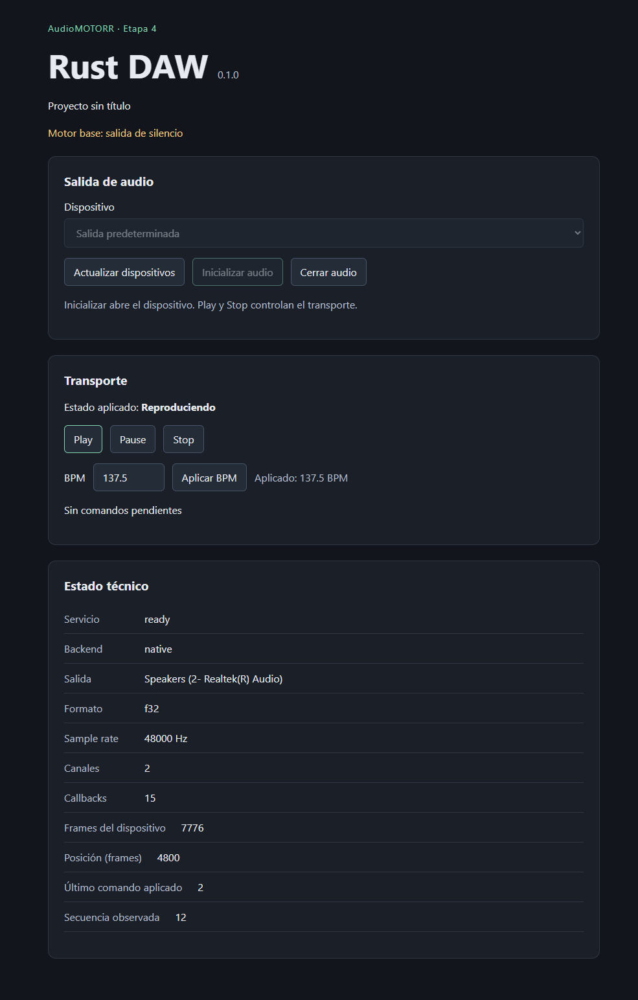
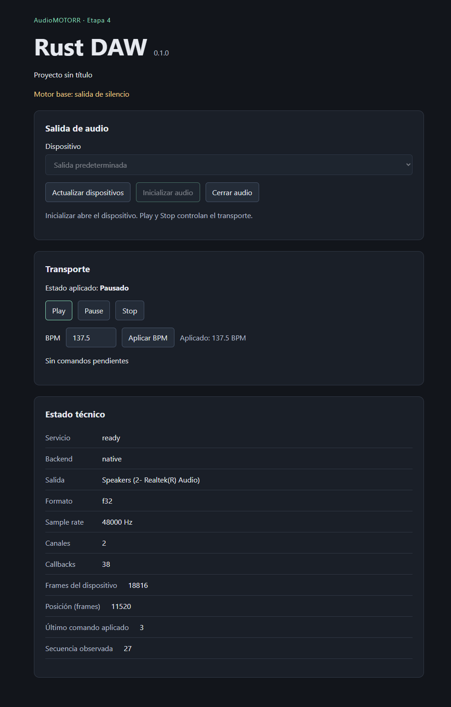
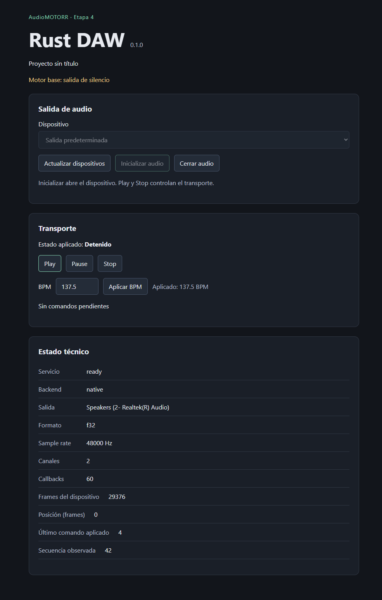
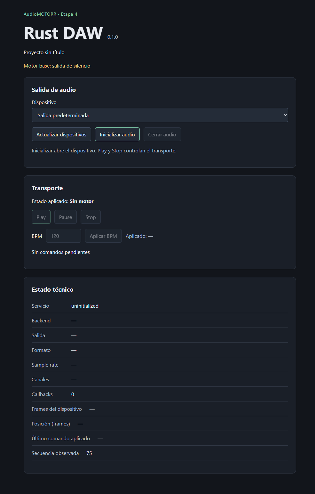

# Walkthrough de la interfaz

Actualizado para etapa 8 el 2026-11-08. Las siete imágenes conservan la UI y
evidencia histórica de etapa 5; no muestran los nuevos controles de senoide.

La etapa 9.4.c (2026-11-09) añade carga WAV y controles sampler. Consulta la
[guía del sampler](06-sampler.md) para ese flujo; las capturas se conservan.

## 1. Navegador y escritorio

```powershell
npm run dev
```

Abrir http://127.0.0.1:1420. Debe mostrarse «Vista de interfaz: requiere Tauri para
audio», con operaciones nativas deshabilitadas. No hay dispositivos simulados.
Detener Vite con Ctrl+C antes del siguiente comando, que usa el mismo puerto:

```powershell
npm run desktop:dev
```

La ventana muestra el proyecto, dispositivos y transporte. Inicialmente el servicio
está sin inicializar y Play está deshabilitado. El montaje de React no abre audio.



## 2. Error de inicialización y recuperación

Si no hay salida disponible, inicializar debe mostrar un error y mantener el
transporte deshabilitado. El recorrido automatizado usa un ID inexistente mediante
IPC para probar esta ruta de manera reproducible; no hay un botón que fabrique
errores en la interfaz ni es necesario desconectar físicamente el dispositivo.



Seleccionar salida predeterminada o un dispositivo enumerado y pulsar
**Inicializar audio**. Esperar servicio `ready`. Un contador de callbacks mayor
que cero confirma procesamiento; `ready` por sí solo confirma apertura del stream.

## 3. Play y BPM

Pulsar Play, esperar «Reproduciendo», escribir `137.5` en BPM y pulsar Aplicar BPM.
Esperar «Aplicado: 137.5 BPM». La posición y los frames del dispositivo avanzan.
Un comando aceptado puede aparecer como pendiente antes de aplicarse; no se cambia
optimistamente el estado observado. Con hardware rápido ese pendiente puede ser breve.



## 4. Pause

Pulsar Pause y esperar «Pausado». La posición musical se conserva, mientras el
dispositivo sigue procesando silencio. Play reanuda desde esa posición.



## 5. Stop

Pulsar Stop y esperar «Detenido». La posición vuelve a cero; el contador de frames
del dispositivo no se reinicia y el stream sigue abierto.



## 6. Cerrar y reiniciar el audio

Pulsar Cerrar audio: el servicio vuelve a `uninitialized`. Volver a inicializar:
el motor comienza detenido, con contadores nuevos y el tempo del documento
conservado. Para cambiar de dispositivo, cerrar primero la salida actual.


Cerrar audio otra vez: Play, Pause, Stop y BPM quedan deshabilitados. Cerrar la
ventana termina el publicador y el servicio; no se guarda el proyecto en disco.



## Regenerar estas capturas

Para comprobar la senoide sin reemplazar las capturas históricas:

1. Antes de inicializar, seleccionar **Senoide · amplitud máxima 0.1** y dejar
   440 Hz (entrada UI: 1–20000 Hz; el dispositivo además exige frecuencia bajo Nyquist).
2. Inicializar y pulsar Play. La voz arranca con rampa de 5 ms.
3. Aplicar volumen 0.25. Esperar ganancia observada 0.250, sin confundir aceptación
   del comando con final de rampa. El nivel es relativo a la voz de pico 0.1.
4. Pause libera 5 ms antes de conservar fase/posición. Play reanuda con ataque;
   Stop libera y después reinicia posición/fase. La UI puede omitir la transición
   breve porque recibe snapshots a menos de 15 Hz.
5. Para cambiar fuente/frecuencia, cerrar e inicializar. Reinicia detenido con
   ganancia efectiva cero, objetivo uno y BPM conservado.

```powershell
npm run check
npm run desktop:build -- --debug --no-bundle
powershell -NoProfile -File scripts/desktop-smoke.ps1 -Sine
```

Este modo comprueba también error/recuperación, BPM, cierre/reapertura y guarda
target/desktop-stage8.png. Rechaza combinar -Sine con -UpdateDocs. El
[reporte](../progress/etapa-8.md) conserva el resultado real de cada verificación.
La [captura nueva de etapa 8](../docs/screenshots/stage8-native-sine.png) y sus
[metadatos](../docs/screenshots/stage8-native-sine.json) registran la UI nativa
verificada el 2026-11-08 sin sustituir las imágenes anteriores.

Para sustituir explícitamente las imágenes del recorrido histórico:

```powershell
npm run check
npm run desktop:build -- --debug --no-bundle
powershell -NoProfile -File scripts/desktop-smoke.ps1 -UpdateDocs
```

El modo UpdateDocs reemplaza explícitamente los PNG y metadata.json de esta guía.
Sin ese switch, el smoke solo guarda su captura local en target/desktop-stage4.png.
Requiere hardware, WebView2 y el puerto local 9223 libre; detecta el puerto ocupado
antes de abrir la aplicación. El script restaura sus variables de entorno y cierra
la ventana. No ejecutar comandos Cargo entre build y smoke: pueden sustituir el
ejecutable empaquetado por uno que espera el servidor de desarrollo.
