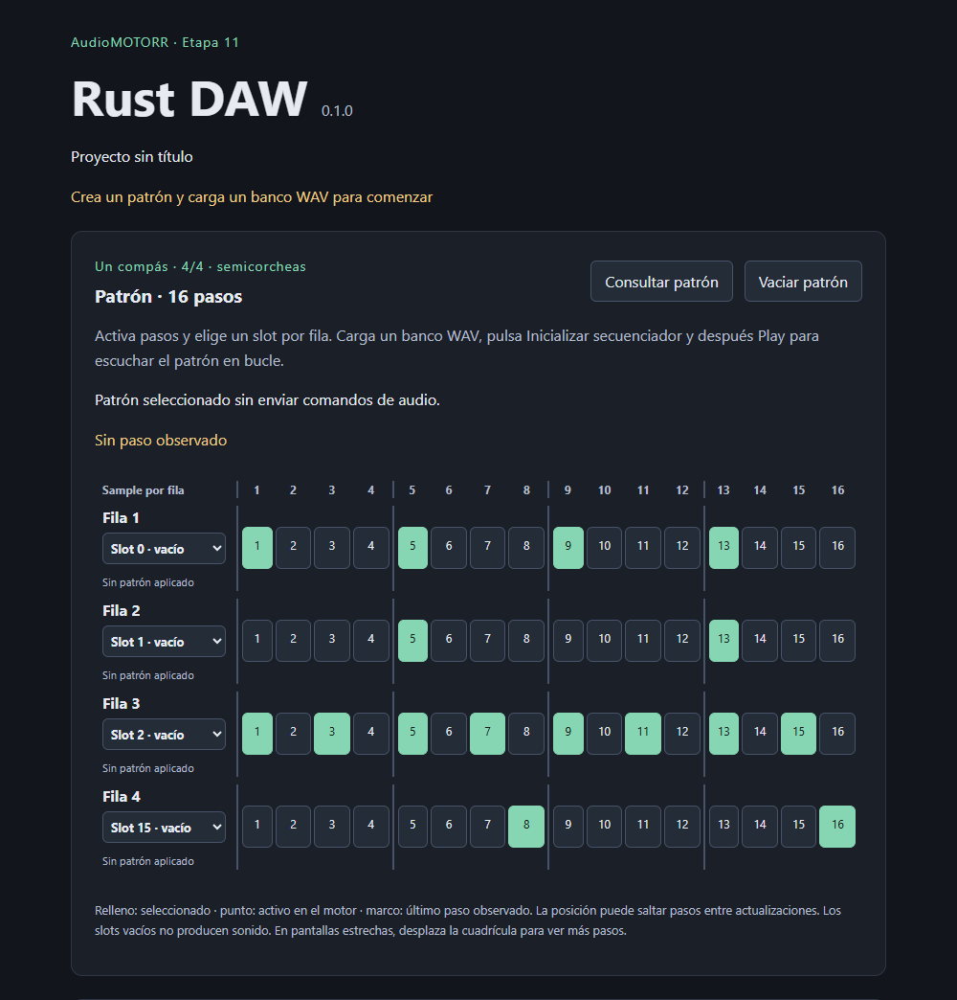

# Crear y reproducir un patrón de 16 pasos

La cuadrícula está implementada en 11.3.c. Ejecuta desde la raíz:

```powershell
npm run desktop:dev
```

`npm run dev` permite ver la interfaz en http://127.0.0.1:1420, con operaciones
nativas deshabilitadas. Detén ese servidor antes de iniciar desktop:dev.

1. Con audio cerrado, activa pasos de las cuatro filas y selecciona un slot por
   fila. Los 16 pasos forman un compás de 4/4 con semicorcheas. El relleno verde
   muestra lo seleccionado en el documento, todavía sin abrir audio.
2. En Sampler, indica archivos WAV PCM16/float32, su frecuencia y salida
   mono/estéreo; añade rutas para los slots que vas a usar. Pulsa **Cargar banco WAV**.
   La frecuencia y canales deben ser compatibles con el dispositivo.
3. Elige la salida del sampler y pulsa **Inicializar secuenciador**. Este botón
   consume el banco preparado y abre la sesión detenida con patrón, tempo y mezcla
   actuales. Si falla, cierra el error de audio con **Cerrar audio** y prepara otro banco.
4. Pulsa **Play**. El motor repite el patrón. Puedes editar pasos/slots, cambiar
   BPM y aplicar gain/pan/mute del mezclador durante la reproducción.
5. **Pause** conserva la fase musical y deja terminar la rampa de salida;
   **Play** reanuda. **Stop** termina la rampa y reinicia posición/voces, conservando
   patrón y banco. **Cerrar audio** libera el banco y conserva los ajustes en memoria.

El punto de cada celda indica que está activada en el patrón observado del motor;
el marco amarillo muestra el último paso observado. Las actualizaciones de la
interfaz pueden saltarse pasos, especialmente a BPM altos: no son el reloj que
programa las notas. Los frames técnicos del transporte pueden incluir el release;
la fase musical del secuenciador se conserva durante esa salida.

Un cambio aceptado puede quedar pendiente hasta que el motor lo procese. Tras
perder/cerrar una sesión puede quedar con aplicación desconocida. Consultar el
patrón lee el documento seleccionado, sin inventar una confirmación del motor.
Un error de timeout tampoco demuestra que el comando no llegara: consulta ambos
estados antes de volver a aplicar lo deseado.

Los slots vacíos son selecciones válidas, pero sus notas no suenan y aumentan
el contador **sin sample**. Las voces ocupadas pueden rechazar una nota por falta
de voz libre. Esos resultados no deshacen la edición del patrón. Los disparos
manuales comparten las 16 voces y mantienen sus propios resultados y contadores.

**Vaciar patrón** desactiva los futuros disparos en una sola operación; no corta
samples que ya están sonando. Usa Stop para detenerlos. En una pantalla estrecha,
desplaza la cuadrícula horizontalmente para acceder a los 16 pasos.



[Vista estrecha de 360 px](../docs/screenshots/stage11-sequencer-narrow.png) y
[metadatos de captura](../docs/screenshots/stage11-sequencer.json). Las capturas
verifican edición y layout reales, con audio sin inicializar. No documentan una
escucha ni medición nativa del secuenciador; esas verificaciones siguen en 11.4.

El patrón vive en memoria: cerrar la aplicación lo pierde. Guardar/abrir proyectos
y exportar el beat corresponden a la etapa 12. Ver [reporte](../progress/etapa-11-desktop-secuenciador.md).
