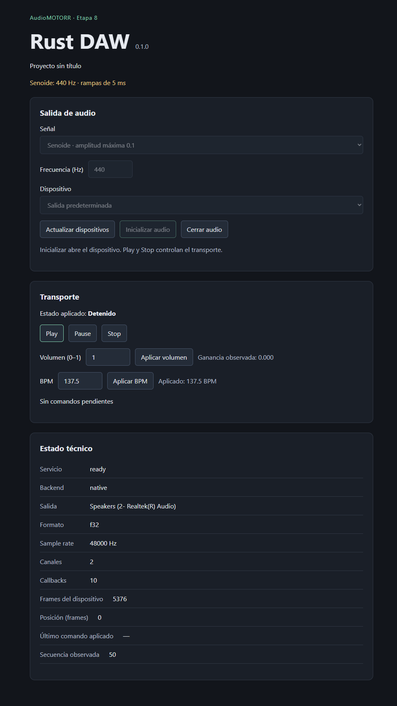

# Etapa 8 — Senoide nativa, rampas y mediciones

Fecha: 2026-11-08. Base: main 818e84b (cierre documental de etapa 7);
implementación previa c6cf627, CI correcta en run 42419963899. El incremento
actual está completado y publicado en 1e6bca8, con comprobaciones locales y ambos
jobs CI correctos para ese SHA. Los resultados locales, físicos y remotos se
detallan por separado; la evidencia de etapa 7 se conserva como historial.

## Implementación y aceptación

| Subetapa / criterio         | Implementación y evidencia                                                                                                                                                                                                                                      |
| --------------------------- | --------------------------------------------------------------------------------------------------------------------------------------------------------------------------------------------------------------------------------------------------------------- |
| 8.1, DSP único y rampas     | Gain validado, with_ramped_sine y rampas de ceil(rate/200) frames; cuatro tests nuevos de referencia, retarget/transporte, particiones 1/127/256/4096 y errores. Overflow también conserva fase/envelope. Offline/WAV inmediato permanece igual.                |
| 8.2, servicio/aplicación    | Inicialización manual/nativa explícita con frecuencia, voz de pico fijo 0.1, volumen FIFO. Test de aceptación/aplicación, release y reinicio. Test nativo compara chunks reales con referencia offline y verifica presupuesto de comandos una vez por callback. |
| 8.3, IPC/UI                 | initialize_audio admite frecuencia opcional, signal_set_gain es el undécimo comando, ACL y DTO/TS regenerados. Fuente/frecuencia/volumen con inicialización explícita; mock IPC y frontend cubren el control y estado observado.                                |
| 8.4, mediciones release     | Feature opcional rt-diagnostics; allocator por hilo y tiempos del procesamiento, probes de muestras antes de conversión; engine-bench y tone-check. Resultados abajo.                                                                                           |
| 8.5, documentación y cierre | Contrato native-audition, arquitectura/realtime/roadmap/README/guías y progreso actualizados. Check completo, build Windows y smoke WebView2 correctos. Publicación/CI del nuevo SHA se registran por separado.                                                 |

with_sine mantiene el contrato de exportación. with_ramped_sine añade ataque,
retarget y release sin duplicar el oscilador. Pause/Stop siguen reproduciendo
durante la cola de 5 ms; los snapshots separan transporte solicitado/actual y
ganancia efectiva/objetivo. Una confirmación de comando no confirma fin de rampa.
Shutdown/error pueden cerrar sin fade; no se cambia el documento salvo BPM.

Cargo.lock incorpora deliberadamente allocation-counter 0.8.1, opcional y fuera
del motor. package-lock.json no requiere cambios. Los bindings cambian por los
campos de observación; regenerarlos debe producir exactamente el nuevo archivo.
check añade tests de audio con native-audio,rt-diagnostics y Clippy del CLI
diagnóstico. No abre hardware en CI; la prueba física permanece ignorada.

## Equipo y procedimiento de medición

- Windows 11 Pro x64, versión de kernel 10.0.26200.
- Intel Core i7-1185G7 @ 3.00 GHz, 4 cores / 8 procesadores lógicos.
- Speakers (2- Realtek(R) Audio), WASAPI, f32, 48000 Hz, estéreo.
- ID usado al reabrir: wasapi:{0.0.0.00000000}.{7ca1b2e0-ec85-4d31-bc07-f036d5ce34a3}.
- Rust 1.90.0, perfil release con instrumentación; tono 440 Hz, pico 0.1,
  rampas 240 frames; comandos Play, gain 0.25, Pause, Play, Stop, cierre/reapertura.

```powershell
cargo build -p daw-cli --release --features rt-diagnostics --locked
target/release/daw-cli.exe tone-check --seconds 2
foreach ($blockSize in @(1,127,256,4096)) {
  target/release/daw-cli.exe engine-bench --block-size $blockSize --iterations 20000
}
```

Prueba final release: correcta, 206 callbacks medidos, tamaños 480–1056 frames,
máximo de procesamiento 41700 ns, carga máxima 0.00417 (0.417 % del intervalo),
cero excesos del presupuesto nominal, cero asignaciones/bytes medidos,
pico 0.1, salto máximo entre muestras 0.0057587707 (límite 0.0061762533),
cero muestras no finitas. Reapertura: 2 callbacks observados; cierre final
Uninitialized. Una pasada previa sin campos min/max también pasó: 206 callbacks,
55200 ns máximo, ratio 0.00552, cero asignaciones/excesos y 1 callback al reabrir.
La variación entre pasadas queda registrada; no se trata de un benchmark estable.

Microbench final, 20000 bloques por tamaño, sin dispositivo:

| Frames/bloque | p50 ns | p99 ns | Máximo ns | Ratio máximo | Excesos | Asignaciones |
| ------------- | ------ | ------ | --------- | ------------ | ------- | ------------ |
| 1             | 0      | 100    | 6600      | 0.316800     | 0       | 0            |
| 127           | 800    | 1500   | 19100     | 0.007219     | 0       | 0            |
| 256           | 1700   | 2700   | 52200     | 0.009788     | 0       | 0            |
| 4096          | 26500  | 63900  | 5540100   | 0.064923     | 0       | 0            |

En la primera pasada los máximos fueron 13200/52000/83300/5519700 ns para los
mismos bloques; todos sin asignaciones ni excesos. p50 cero con bloque 1 refleja
la resolución del reloj, no procesamiento gratuito. Son muestras cortas con
instrumentación y carga/scheduler local, no garantía de tiempo real.

## Comprobaciones finales

- npm run bindings:generate y bindings:check: regeneración determinista; hash nuevo
  sin cambios después de regenerar.
- npm run check: correcto; 13 tests frontend, 46 Rust headless, 51 Rust workspace
  (incluye 3 IPC y 1 publicador), nueve escenarios CLI, formato, TypeScript,
  ESLint, build frontend y Clippy con warnings como errores.
- Variante native-audio,rt-diagnostics incorporada al check: 14 pruebas correctas,
  1 de hardware ignorada; Clippy del CLI diagnóstico correcto. No sumar estos
  resultados con workspace/headless: comparten cobertura.
- npm run desktop:build -- --debug --no-bundle: correcto después de check.
- powershell -NoProfile -File scripts/desktop-smoke.ps1 -Sine: correcto sobre
  WebView2 y Realtek; fuente 440 Hz, volumen aplicado 0.25, error por ID ausente y
  recuperación, Play/Pause/Stop, BPM 137.5, cierre/reinicio y salida normal de
  ventana. Primera pasada: 43 callbacks y último ID 5 antes del cierre.
- Revisión visual: se corrigió el espaciado entre frecuencia y dispositivo;
  formato CSS, recompilación con TypeScript/Vite y smoke final correctos después
  del cambio. Pasada final: 48 callbacks y último ID 5 antes de cerrar, tempo de
  reinicio 137.5 y cierre normal de ventana. No hubo cambios musicales posteriores
  al check completo.
- Enlaces locales y actionlint correctos; workflow sin cambios. git diff --check
  correcto. Los reportes/capturas de etapas anteriores permanecen intactos.

Clippy detectó dos enums demasiado grandes al ampliar snapshots/diagnósticos.
Se resolvió reservando Box para las respuestas de control y el procesador manual
fuera del callback, sin desactivar el lint ni cambiar las colas Copy.

Hashes SHA-256 después de fijar los cambios; idénticos antes/después de
regeneración y check (package-lock.json además conserva su hash de etapa 7):

| Archivo                         | SHA-256                                                          |
| ------------------------------- | ---------------------------------------------------------------- |
| Cargo.lock                      | 1A3F4C34AC94A2040057545B28DA8243864CC4E69FA639728C483D00D8AE9C58 |
| package-lock.json               | ABCCDCEAE11E9A00DCF184D6039B2E55FC8397CDF4204C883DDEB2B61BA4CFBD |
| src/shared/api/generated/api.ts | CD72C52812C3AD12D3845A127EB9B16C8B90A41640F2118A6C34B583573E26FE |

## Publicación y CI

Implementación publicada en main:
[1e6bca878b73c99e3c2342b7e6e18af2b0ba799d](https://github.com/YoZaiKK/AudioMOTORR/commit/1e6bca878b73c99e3c2342b7e6e18af2b0ba799d).
La [ejecución 42524752652](https://github.com/YoZaiKK/AudioMOTORR/actions/runs/42524752652)
corresponde a ese SHA exacto. Ambos jobs terminaron completed/success;
inspección por API oficial el 2026-11-08 a las 21:26:39 UTC:

| Job             | Resultado | Evidencia                                                                                               |
| --------------- | --------- | ------------------------------------------------------------------------------------------------------- |
| headless-linux  | success   | [Ubuntu 24.04](https://github.com/YoZaiKK/AudioMOTORR/actions/runs/42524752652/job/128865772078)        |
| desktop-windows | success   | [Windows Server 2022](https://github.com/YoZaiKK/AudioMOTORR/actions/runs/42524752652/job/128865771748) |

CI ejecutó pruebas sin hardware y build desktop debug sin instalador. Las pruebas
Realtek/WebView2 y mediciones release pertenecen al equipo local identificado
arriba. Etapa 8 cerrada con estas limitaciones; el cierre documental posterior
no cambia el código de audio y tendrá su propia ejecución remota.

## Límites y siguiente paso

Los tiempos incluyen drenaje de comandos, DSP, conversión, probes y publicación
del snapshot; excluyen CPAL/driver y llegada del callback. El allocator solo
mide el hilo actual. Las métricas temporales se publican un callback después;
puede quedar un último callback sin publicar. No miden CPU global ni latencia
de salida. Las muestras observadas son f32 antes de conversión, primer canal
idéntico al resto; el salto acotado no demuestra continuidad acústica.

Pendientes: loopback/escucha controlada, desconexión física, estrés prolongado,
otros dispositivos/formatos físicos, Linux nativo y macOS. La CI de futuros cambios
solo puede declararse correcta al inspeccionar una ejecución del SHA publicado.
Se conservan reportes y siete capturas históricas de etapa 5 con sus fechas.

Captura nueva, 2026-11-08, después de reiniciar audio: servicio ready, senoide
440 Hz, detenido, ganancia efectiva cero y BPM conservado. Los contadores de
esta imagen corresponden al stream reiniciado y difieren de los 48 anteriores.
Ver [metadatos y hash](../docs/screenshots/stage8-native-sine.json).



Siguiente cambio concreto: 9.1, contrato del sampler y fixtures en memoria:
formato/rate/canales, propiedad inmutable, pool fijo de voces y política de
agotamiento. Después, reproducción determinista dentro de daw-engine; carga y
decodificación fuera del callback mediante daw-app. Sin implementar aún mezclador,
secuenciador o persistencia. Ver [roadmap](../docs/roadmap.md) y [plan](plan-etapas-7-13.md).
