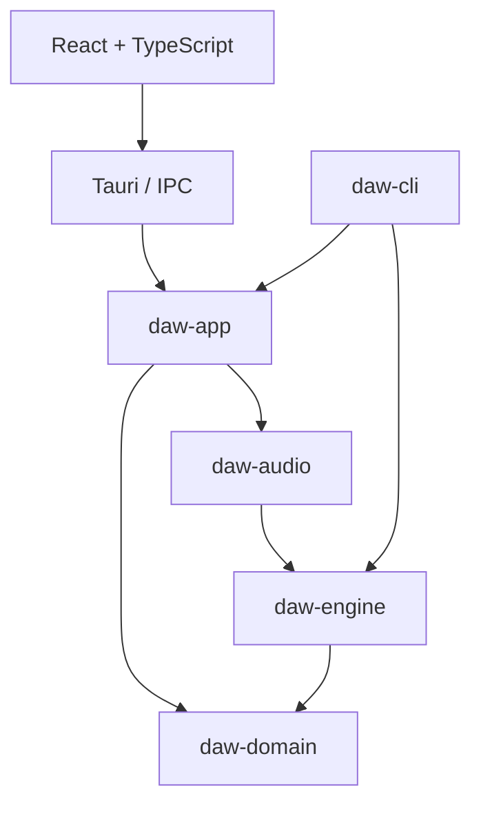

# Rust DAW — Prompt de implementación de la plantilla

Este prompt crea el fundamento ejecutable del proyecto. El primer resultado procesa silencio y confirma la comunicación entre React, Tauri y Rust. El siguiente hito será generar una señal y verificar su continuidad entre bloques.

## Prompt listo para Codex CLI / Copilot

Actúa como un desarrollador senior de Rust, audio en tiempo real y aplicaciones desktop con Tauri 2, React y TypeScript.

Implementa la plantilla funcional de **Rust DAW**, una aplicación de escritorio que evolucionará desde una groovebox de cuatro canales y 16 pasos hacia una DAW basada en clips. El entorno principal es Windows 11 nativo, con MSVC, WebView2 y VS Code. Conserva la posibilidad de desarrollar y compilar en Linux y macOS mediante sus dependencias nativas.

Completa la implementación y las verificaciones dentro del alcance siguiente. Resuelve las decisiones rutinarias sin detenerte a pedir aprobación. Si faltan herramientas, documenta el bloqueo concreto y continúa con las partes verificables. No presentes como ejecutadas pruebas que no pudiste realizar.

### 1. Inspección e inicialización

1. Lee los AGENTS.md aplicables y revisa el directorio actual antes de modificarlo.
2. Si existe un proyecto Tauri o React, identifica sus versiones y conserva el código y configuración útiles. Refactoriza lo necesario para obtener esta arquitectura, respetando los cambios ajenos. No ejecutes un generador encima de archivos existentes.
3. Si el directorio está vacío, inicializa React + TypeScript + Vite y Tauri 2 con el generador oficial o su estructura equivalente. No uses Create React App, Next.js, SSR, Electron, Wails, Docker ni servicios remotos.
4. Usa npm y un único package-lock.json. Usa un único Cargo workspace y Cargo.lock en la raíz.
5. Consulta las APIs oficiales actuales y elige versiones estables compatibles, sin prereleases. Registra las versiones concretas instaladas. Fija Rust en rust-toolchain.toml y Node en un archivo de versión; configura package.json para comprobar la compatibilidad. No inventes versiones.
6. Usa Rust edition 2024 y resolver 3 si son compatibles con la toolchain seleccionada. La raíz Cargo.toml es un workspace virtual. Comparte metadatos, dependencias y perfiles desde él. No crees workspaces anidados.
7. Mantén el JavaScript project en la raíz y src-tauri/ en su ubicación habitual para reducir configuración especial.

### 2. Arquitectura obligatoria

Implementa cuatro bibliotecas Rust, una CLI y el adaptador Tauri:

| Paquete | Responsabilidad | Dependencias internas permitidas |
|---|---|---|
| daw-domain | Documento editable mínimo, IDs y tipos musicales validados. | Ninguna. |
| daw-engine | Estado de reproducción, transporte, comandos de tiempo real y renderizado determinista. | daw-domain, solo si necesita sus tipos. |
| daw-audio | Lifecycle del servicio de audio, backend CPAL, backend sin dispositivo y comunicación con el callback. | daw-engine. |
| daw-app | Casos de uso y coordinación del documento y el servicio de audio; API para Tauri y CLI. | daw-domain, daw-audio; daw-engine solo cuando sea necesario para tipos públicos. |
| daw-cli | Herramienta ejecutable para verificar el núcleo sin React/Tauri. | daw-app, daw-engine. |
| rust-daw-desktop | Adaptador Tauri, comandos IPC, DTO y publicaciones hacia React. | daw-app; bibliotecas de serialización/bindings. |

Reglas:

- daw-domain no importa Tauri, React, CPAL ni objetos del sistema operativo.
- daw-engine no importa Tauri, CPAL, IPC, formatos JSON, archivos ni el runtime asíncrono.
- daw-audio no importa Tauri y concentra CPAL y las colas entre hilos.
- daw-app no importa Tauri. Sus casos de uso se pueden llamar desde la CLI.
- src-tauri es una capa delgada de adaptación y composición. No contiene algoritmos DSP ni el documento completo duplicado.
- React no controla el reloj musical ni procesa audio. Los timers de la UI solo pueden servir para visualización o consultas.
- No crees microservicios ni conviertas cada futuro módulo musical en un crate. Sampler, secuenciador, mixer y DSP comenzarán como módulos internos de daw-engine cuando se implementen.

Diagrama de dependencias, donde A --> B significa «A depende de B»:



La separación entre documento editable y estado de reproducción debe quedar documentada. En este primer alcance no transfieras proyectos, strings, buffers grandes ni estructuras serializadas al callback: solo comandos pequeños de tamaño acotado.

### 3. Estructura de carpetas

Construye esta estructura. Puedes agrupar archivos pequeños si mejora la claridad, manteniendo estos límites. No crees carpetas vacías para funcionalidades futuras.

```text
rust-daw/
├── Cargo.toml
├── Cargo.lock
├── rust-toolchain.toml
├── package.json
├── package-lock.json
├── .node-version
├── .gitignore
├── .editorconfig
├── index.html
├── vite.config.ts
├── tsconfig.json
├── eslint.config.js
├── public/
├── src/
│   ├── main.tsx
│   ├── app/
│   │   ├── App.tsx
│   │   ├── providers.tsx
│   │   └── styles.css
│   ├── features/
│   │   ├── transport/
│   │   │   ├── TransportBar.tsx
│   │   │   └── useTransport.ts
│   │   ├── audio-settings/
│   │   │   ├── AudioSettingsPanel.tsx
│   │   │   └── useAudioSettings.ts
│   │   └── engine-status/
│   │       ├── EngineStatusPanel.tsx
│   │       └── useEngineSnapshot.ts
│   ├── entities/
│   │   └── project/
│   │       └── project.types.ts
│   └── shared/
│       ├── api/
│       │   ├── desktop-client.ts
│       │   ├── errors.ts
│       │   └── generated/
│       ├── hooks/
│       └── ui/
├── src-tauri/
│   ├── Cargo.toml
│   ├── build.rs
│   ├── tauri.conf.json
│   ├── capabilities/default.json
│   ├── icons/
│   └── src/
│       ├── main.rs
│       ├── lib.rs
│       ├── state.rs
│       └── ipc/
│           ├── mod.rs
│           ├── commands.rs
│           ├── dto.rs
│           ├── errors.rs
│           └── telemetry.rs
├── crates/
│   ├── daw-domain/
│   │   ├── Cargo.toml
│   │   └── src/{lib.rs,ids.rs,project.rs,time.rs}
│   ├── daw-engine/
│   │   ├── Cargo.toml
│   │   ├── src/{lib.rs,config.rs,engine.rs,transport.rs,commands.rs,snapshot.rs}
│   │   └── tests/render_contract.rs
│   ├── daw-audio/
│   │   ├── Cargo.toml
│   │   └── src/
│   │       ├── lib.rs
│   │       ├── service.rs
│   │       ├── queues.rs
│   │       ├── error.rs
│   │       └── backend/{mod.rs,manual.rs,cpal.rs}
│   ├── daw-app/
│   │   ├── Cargo.toml
│   │   └── src/{lib.rs,application.rs,error.rs}
│   └── daw-cli/
│       ├── Cargo.toml
│       └── src/main.rs
├── scripts/
│   ├── doctor.ps1
│   └── check.mjs
├── docs/
│   ├── architecture.md
│   ├── realtime-contract.md
│   ├── development-windows.md
│   ├── roadmap.md
│   └── decisions/0001-workspace-and-audio-boundaries.md
├── .github/workflows/ci.yml
└── README.md
```

La notación con llaves enumera archivos individuales, no nombres literales. Crea hooks, providers y componentes compartidos solo cuando tengan un uso real; elimina directorios sin contenido útil. Mantén src-tauri/main.rs mínimo y compón la aplicación en lib.rs. Conserva el código inicial necesario de Tauri, sus iconos y build.rs.

### 4. Núcleo y primer contrato ejecutable

Implementa realmente:

- EngineConfig validada: frecuencia de muestreo y número de canales, ambos positivos y compatibles con la implementación.
- AudioEngine, dueño de su Transport y estado de reproducción.
- Una operación de render equivalente a render_interleaved(&mut self, output: &mut [f32]). Documenta la intercalación de canales. Su interfaz final puede incluir un contexto ligero si aporta claridad.
- El llamador proporciona el buffer. El motor escribe todas sus muestras y acepta tamaños variables alineados a frames. Maneja entradas inválidas de forma explícita fuera del callback; el adaptador garantiza los invariantes del callback y escribe silencio seguro si detecta una configuración inesperada.
- La implementación inicial produce exclusivamente silencio; es una base para desarrollar el motor. No construyas un sintetizador o sampler en esta tarea.
- Device frame counter y transport frame position separados: el primero avanza en cada bloque procesado; el segundo solo mientras el transporte está reproduciendo.
- Play reanuda desde la posición actual; Pause conserva la posición; Stop la devuelve a cero. Mientras el stream siga activo, los callbacks continúan produciendo silencio incluso con el transporte detenido.
- SetTempo valida valores finitos dentro de un intervalo documentado, por ejemplo 20–300 BPM. Este cambio actualiza estado, pero no implementa todavía scheduling de eventos.
- En la plantilla, estos cambios se aplican al inicio de un bloque. Documenta que las notas del futuro secuenciador necesitarán offsets dentro del bloque.

El núcleo debe poder ejecutarse sin dispositivo, ventana, Tauri ni sistema de archivos.

### 5. Backend de audio y concurrencia

Implementa dos backends funcionales:

1. Manual: procesa exactamente los frames solicitados por CLI o tests, sin temporizadores ni dispositivo. Es el camino determinista para CI y desarrollo offline.
2. CPAL: enumera salidas, obtiene configuraciones soportadas y abre un stream que llama al mismo núcleo. Usa la configuración realmente negociada para construir el motor. Empieza con el dispositivo predeterminado; seleccionar otra salida puede requerir detener y volver a abrir el stream. No implementes hot-swap transparente ni ASIO en esta etapa.

CPAL debe quedar detrás de una feature native-audio. Propaga explícitamente esta feature desde daw-app y daw-cli. El paquete Tauri la habilita para desarrollo desktop. La CLI y las pruebas del núcleo deben compilar sin ella. No uses mocks que afirmen haber abierto un dispositivo.

La conversión de formato de salida y el número de canales deben resolverse explícitamente: soporta los formatos negociados que implementes o devuelve UnsupportedSampleFormat/UnsupportedChannels con un mensaje útil. No asumas siempre f32 estéreo. Si necesitas un buffer temporal, préasignalo y procesa el callback en fragmentos dentro de la capacidad. No lo redimensiones durante la reproducción. Respeta el valor de silencio del formato de salida, incluido el punto medio en formatos unsigned.

Modelo de concurrencia:

- Un hilo de control nativo es dueño del stream CPAL y del extremo productor de la cola de comandos de tiempo real.
- Tauri y la CLI acceden mediante un handle de servicio; varias llamadas entrantes se serializan antes de llegar a esa cola SPSC.
- Para solicitudes externas al hilo de control puedes usar un canal normal acotado, con respuesta o timeout apropiado. Este canal nunca se usa desde el callback.
- El callback posee AudioEngine y el consumidor de una cola SPSC preasignada de rtrb. Solo él modifica el estado de reproducción durante el stream.
- Procesa como máximo un número fijo de comandos por callback, por ejemplo 32. Define capacidades, política FIFO y respuesta QueueFull/Busy. No hagas busy-wait, no descartes controles sin informar y no uses un drenado ilimitado.
- Los comandos de tiempo real son datos pequeños, idealmente Copy: IDs, números y enums. No contienen String, Vec, Box ni recursos cuya destrucción pueda liberar memoria en el callback.
- El callback publica snapshots pequeños por una segunda cola SPSC hacia el hilo de control. Si esta cola está llena, puede omitir una publicación de telemetría; mantén un mecanismo monotónico o reintento acotado para que se publique el estado aplicado más reciente después.
- El hilo de control drena snapshots y conserva uno de consulta. Un Mutex para esa copia o un handle del lado de control es admisible; el callback jamás adquiere ese lock.
- Distingue CommandAccepted de CommandApplied. Devuelve un commandId al aceptar una acción y refleja el último comando aplicado en snapshots. La UI no debe presentar como confirmado un cambio que sigue en cola.
- Los contadores internos de frames pueden ser u64. Para atravesar JSON expórtalos como strings decimales si pueden superar el entero seguro de JavaScript; alinea el tipo TypeScript con ese contrato.
- Define startup, shutdown y restart sin filtrar threads ni streams. Construye, utiliza y destruye el stream en su hilo propietario; no asumas que puedes mover cpal::Stream entre cualquier hilo/plataforma.
- Si el stream falla, deja de admitir comandos de transporte y comunica el error; iniciar/reiniciar audio reconstruye el estado según una política documentada. No esperes indefinidamente un acknowledgement de un callback que ya no existe.

Prohibiciones en el callback: I/O, logs, JSON/Serde, llamadas Tauri, promesas, esperas, locks bloqueantes, asignaciones de memoria, crecimiento de colecciones, drops de recursos grandes y panics deliberados. El callback de error también debe limitarse a señalizar; el formateo y los logs ocurren fuera de él.

### 6. Casos de uso, IPC y tipos

Implementa en daw-app y expón mediante comandos Tauri delgados:

- get_app_info
- get_project_summary: documento mínimo nuevo, título e identificador; no implementes persistencia aún.
- list_output_devices
- initialize_audio: dispositivo predeterminado o selección explícita de una salida enumerada.
- shutdown_audio
- get_engine_snapshot
- transport_play
- transport_pause
- transport_stop
- transport_set_tempo

Mantén separados AudioServiceState (uninitialized, ready, error, shuttingDown) y TransportState (stopped, playing, paused). Una respuesta de inicialización exitosa significa que el stream arrancó; la confirmación de que se están procesando callbacks viene de los snapshots, no de un contador inventado en React.

Devuelve errores estructurados: code, message y detalles opcionales serializables. Incluye validación de argumentos, servicio sin inicializar, cola llena, dispositivo ausente, formato no soportado y error del stream. Evita unwrap/expect sobre rutas de operación y datos externos.

Define DTO IPC en Rust, con Serde y ts-rs para generar declaraciones TypeScript en src/shared/api/generated/. Mantén las dependencias de exportación fuera del motor. Implementa npm run bindings:generate y documenta la ruta real; verifica que regenerar no cambie el contrato versionado inesperadamente. Nunca mantengas dos versiones manuales independientes de los DTO. Generar tipos no valida por sí mismo los nombres/argumentos de invoke: centraliza esas llamadas y comprueba al menos una integración real.

Centraliza invoke y listen en desktop-client.ts. Los componentes React usan hooks de dominio y no invocan Tauri directamente. Diferencia claramente documento editable, snapshot observado y estado puramente visual. Usa React Context/useReducer o hooks locales para la plantilla; no añadas una biblioteca de estado global sin un uso concreto.

Publica engine-snapshot como evento Tauri pequeño a un máximo de 15 Hz, desde fuera del callback. Este límite es una decisión de visualización y no un reloj musical. No envíes audio ni waveforms por eventos. Al montar la UI, registra el listener y consulta el snapshot inicial; usa un sequence monotónico para ignorar estados viejos. Limpia listeners y tareas al desmontar y al cerrar, contemplando los montajes adicionales de React StrictMode. Detén publicaciones si la ventana deja de existir.

Configura las capabilities y la CSP de Tauri 2 con el alcance necesario para esta aplicación. Verifica cómo aplican a comandos propios y a plugins; no copies permisos inexistentes. No desactives la seguridad para evitar configurar el proyecto.

### 7. Interfaz mínima funcional

Crea una interfaz sencilla, oscura y legible, con:

- Barra con nombre de aplicación y proyecto.
- Panel de salida de audio, dispositivos disponibles y botones para inicializar/detener el servicio.
- Transporte Play/Pause/Stop y BPM.
- Panel técnico separado con backend, servicio, transporte, sample rate y canales reales, frames procesados, posición y último comando aplicado.
- Mensajes claros de error y acciones deshabilitadas cuando el servicio no está disponible.
- Una nota visible de desarrollo: «Motor base: salida de silencio».

No inicialices el dispositivo automáticamente desde un useEffect de React. La acción explícita de inicializar evita aperturas duplicadas y facilita comprobar el lifecycle. Distingue iniciar/detener el dispositivo de Play/Stop del transporte.

Permite npm run dev para trabajar en el navegador: si no existe el runtime Tauri, muestra «Vista de interfaz: requiere Tauri para audio» y deshabilita funciones nativas. No simules funcionamiento real ni escondas errores de IPC detrás de un fallback automático.

No construyas Session View, timeline, piano roll, editor de plugins ni una UI compleja en esta tarea.

### 8. CLI y herramientas

La CLI ofrece un subcomando smoke que renderiza una duración o cantidad exacta de frames usando el backend manual, comprueba silencio y termina con código de salida apropiado. Permite variar tamaño de bloque. Debe reutilizar AudioEngine; no copies su lógica.

Opcionalmente añade un subcomando devices y un live-smoke detrás de native-audio. Este último abre una salida real durante una duración limitada y cierra ordenadamente; no lo incluyas en tests automáticos que requieran hardware.

Configura estos scripts npm, ajustando su implementación al proyecto real:

- dev: Vite, únicamente UI.
- desktop:dev: tauri dev.
- build: comprobación TypeScript y build Vite.
- desktop:build: tauri build; verifica la coordinación con beforeBuildCommand para evitar recursión.
- typecheck, lint, format:check.
- test:frontend: Vitest en modo de ejecución única.
- bindings:generate.
- check: secuencia multiplataforma y con fallo inmediato para verificaciones estáticas y tests.

No uses sintaxis exclusiva de bash en scripts npm que deban funcionar en Windows. Usa Node para la orquestación cuando haga falta. El doctor.ps1 solo comprueba Rust, Cargo, Node, npm, toolchain MSVC y prerrequisitos de Windows; no instala herramientas ni cambia configuración del sistema silenciosamente. Si no puede verificar algo de forma fiable, lo indica con claridad.

Configura Tauri/Vite con devUrl, puerto fijo/strictPort, frontendDist y beforeDevCommand/beforeBuildCommand correctos. Excluye target/ de los watchers de Vite cuando sea necesario. La configuración debe funcionar con src-tauri como miembro del workspace y target/ compartido en la raíz.

### 9. Pruebas y CI

Escribe pruebas de comportamiento que aporten evidencia:

1. El motor sobrescribe con silencio un buffer que contenía datos no nulos, incluidas llamadas consecutivas de distintos tamaños.
2. El mismo número total de frames produce idéntica posición de transporte con particiones de bloque diferentes.
3. Pause conserva posición; Stop la reinicia; el contador del dispositivo sigue avanzando mientras hay render.
4. BPM inválidos, infinitos y NaN se rechazan.
5. La cola llena se comunica y el límite de comandos por callback se respeta sin perder acciones silenciosamente.
6. Accepted y Applied se distinguen; shutdown y reinicialización se verifican con el backend manual.
7. Un test React verifica que un fallo de inicialización se muestra y no activa el transporte. Si pruebas suscripciones, comprueba la limpieza real de listeners.

Ejecuta y reporta, en los entornos disponibles:

- npm ci después de disponer de un lockfile generado correctamente.
- npm run typecheck, npm run lint, npm run format:check, npm run test:frontend, npm run build.
- cargo fmt --all -- --check.
- cargo clippy --workspace --all-targets -- -D warnings en un host con prerrequisitos nativos.
- cargo test --workspace en ese host.
- Tests/clippy explícitos de los crates headless sin native-audio; no uses --workspace para afirmar que una máquina sin dependencias de Tauri puede compilar todo.
- CLI smoke con varios tamaños de bloque.
- Build desktop debug o equivalente y, si el entorno permite ventanas/audio, smoke manual de abrir, inicializar, Play/Pause/Stop, cerrar y reabrir.

Configura GitHub Actions con un job headless Linux para los crates sin CPAL/Tauri y un job Windows con los prerrequisitos oficiales para frontend y desktop. Ejecuta en CI verificación de bindings generados y lockfiles. No incluyas firma, publicación, releases ni instalación automática en el equipo del usuario. Documenta qué pruebas necesitan hardware y por qué no están en CI.

No afirmes que escuchar silencio demuestra ausencia de dropouts: en esta etapa se comprueban lifecycle, callbacks y contratos. La continuidad audible y los plazos del procesamiento se medirán con una señal en el siguiente hito.

### 10. Documentación y alcance posterior

Entrega README con instalación en Windows, comandos exactos, navegación de paquetes y resolución de los bloqueos que realmente encontraste. Documenta dependencias Linux/macOS si las verificaste; diferencia compatibilidad prevista de compilación comprobada.

architecture.md debe incluir diagramas Mermaid de dependencias y del flujo de control/tiempo real. realtime-contract.md documenta ownership, límites de colas, política de overflow, semántica del transporte, telemetría, formatos y liberación de recursos. Registra las decisiones concretas en el ADR.

roadmap.md debe ordenar los siguientes hitos:

1. Oscilador senoidal de baja amplitud offline, fase continua entre bloques y exportación WAV.
2. Mismo oscilador por CPAL, rampas de ganancia y pruebas de continuidad/carga en release.
3. Sampler y pool fijo de voces; carga/decodificación fuera del callback.
4. Mezclador de cuatro canales, gain/pan/mute y medidores.
5. Secuenciador de 16 pasos con eventos a offsets dentro de cada bloque y pruebas a tempos no enteros en frames.
6. Documento versionado, guardar/abrir, recursos relativos y exportación de un beat.
7. Clips/escenas; después timeline, piano roll y automatización.

Para esos módulos define responsabilidades en la documentación; no añadas implementaciones vacías, traits genéricos sin uso ni dependencias todavía innecesarias. Deja para fases posteriores grabación, MIDI externo, time-stretching, hosting VST/CLAP, routing complejo, compensación de latencia y colaboración.

### 11. Criterio de finalización

La tarea termina cuando la estructura existe, los crates tienen responsabilidades reales, React abre dentro de Tauri, las llamadas atraviesan daw-app, el backend manual es determinista, el backend nativo puede abrir una salida compatible y procesar silencio, los controles reflejan estado aplicado y el cierre libera recursos. Si no tienes acceso al hardware o a Windows, entrega las partes completadas y enumera con precisión las validaciones pendientes, sin sustituirlas por simulaciones.

En la respuesta final resume archivos creados, decisiones relevantes, versiones instaladas, comandos comprobados y limitaciones observadas. Indica el siguiente cambio concreto: añadir el oscilador dentro de daw-engine reutilizando el contrato de render. No implementes ese siguiente hito ni publiques nada durante esta tarea.

## Referencias oficiales para ejecutar el prompt

- Tauri: https://v2.tauri.app/start/project-structure/
- Tauri + frontend: https://v2.tauri.app/start/frontend/
- Prerrequisitos: https://v2.tauri.app/start/prerequisites/
- Comandos: https://v2.tauri.app/develop/calling-rust/
- Eventos y canales: https://v2.tauri.app/develop/calling-frontend/
- Cargo workspace: https://doc.rust-lang.org/cargo/reference/workspaces.html
- CPAL: https://docs.rs/cpal/latest/cpal/
- rtrb: https://docs.rs/rtrb/latest/rtrb/
- ts-rs: https://docs.rs/ts-rs/latest/ts_rs/
